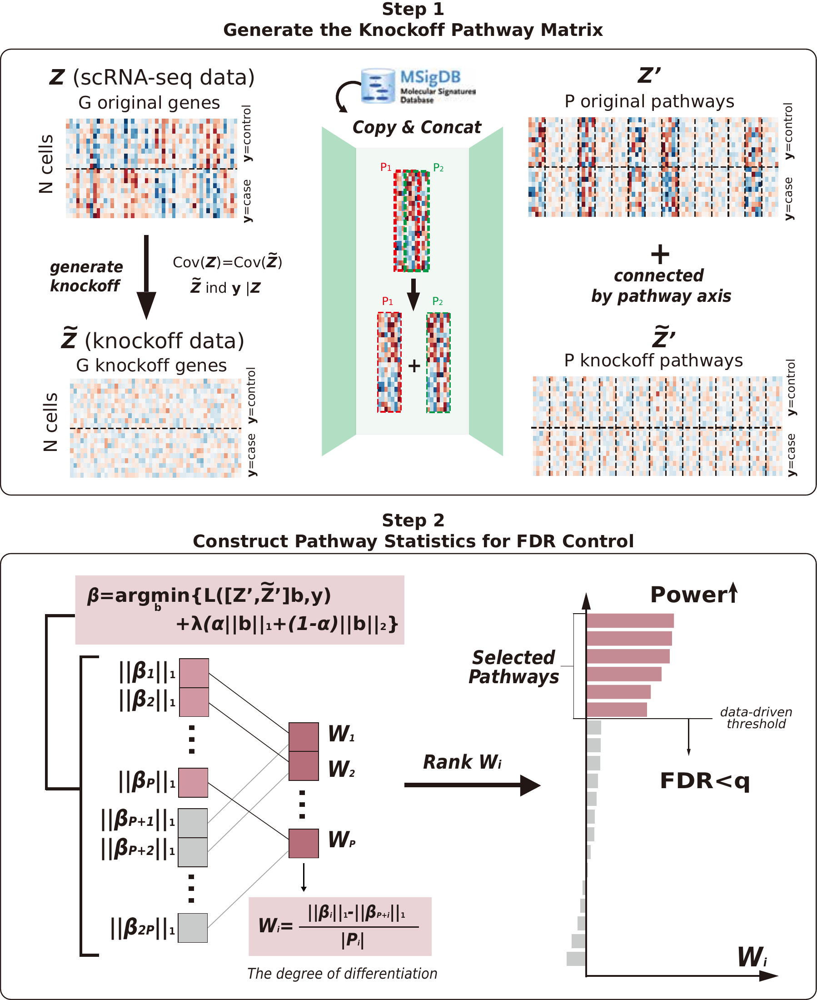
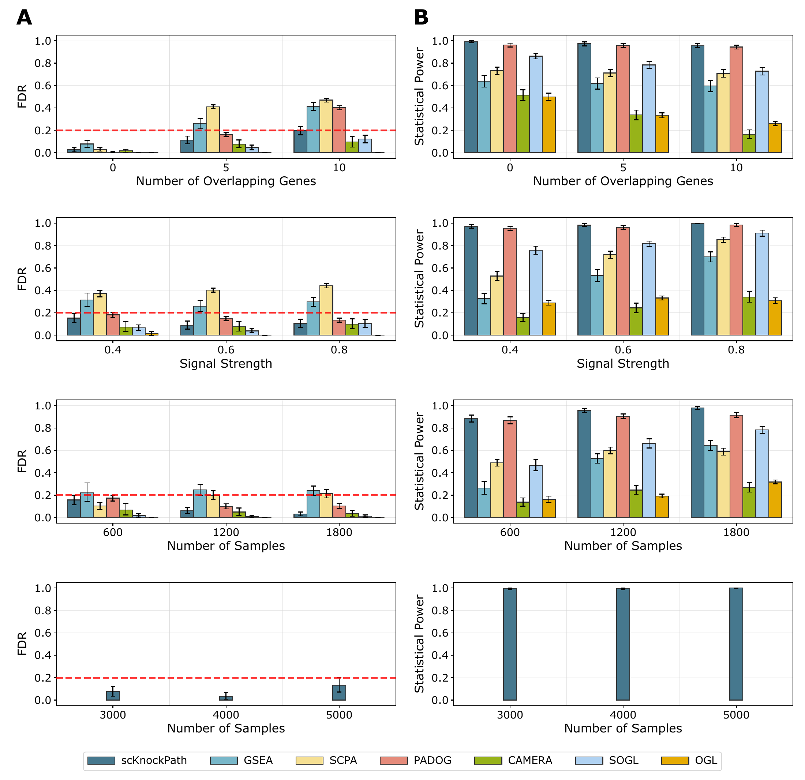

# scKnockPath — GPU-accelerated pathway discovery

scKnockPath identifies differential pathways from single-cell expression data using Gaussian model-X knockoffs and logistic sparse-group lasso. The **CUDA/PyTorch implementation** accelerates pathway unfolding, knockoff construction, and batched cross-validation.



## Install

Use Linux, Python 3.11, and an NVIDIA GPU with a compatible driver. From this directory:

```bash
export PYTHONNOUSERSITE=1
conda env create -f environment.yml
conda activate sckp-gpu
# Example CUDA 12.8 build; choose a driver-compatible build if needed.
python -m pip install torch==2.8.0 --index-url https://download.pytorch.org/whl/cu128
python -m pip check
python -c "import torch; print(torch.cuda.is_available())"
python tests/smoke_gpu.py  # Small GPU test; no downloaded data needed
```

See the [PyTorch installation guide](https://pytorch.org/get-started/locally/) for other CUDA builds. Simulation generation additionally requires R and [scDesign3](https://github.com/SONGDONGYUAN1994/scDesign3): `Rscript --vanilla simulation/install.R`.

## Run on your data

Supply a normalized, log1p-transformed `.h5ad` file with binary phenotype labels and a gene-symbol `.gmt` pathway library:

```bash
CUDA_VISIBLE_DEVICES=0 python scripts/run_gpu.py \
  --mode real --adata data/processed.h5ad --gmt data/pathways.gmt \
  --label disease --control normal --case disease \
  --out results/my_analysis
```

Use `--gene-names feature_name` if symbols are stored in that `.var` column rather than `.var_names`. Outputs include pathway scores/selections, coefficients, CV errors, and convergence flags. The default is Ledoit–Wolf covariance, α=0.3, q=0.2, and three-fold CV minimizing classification error; exact ties select the largest λ. Fits stop at 3,000 iterations. See [running details](docs/RUNNING.md) for real-data commands and options.

## Simulations and Fig. 2

The scDesign3 generators download their reference through DuoClustering2018; no datasets are bundled.

```bash
# Generate one dataset, then run the GPU analysis.
Rscript --vanilla simulation/gen_sample_own.r 600 46 46 4
CUDA_VISIBLE_DEVICES=0 python scripts/run_gpu.py \
  --mode simulation \
  --adata data/simulation/sampleown_data/sampleown=600/simu_scRNAseq_100pathways_600sampleown_seed=46.h5ad \
  --seed 46 --out results/sample600_seed46
```



The figure is the manuscript benchmark, including comparator methods. The portable batch entry point reproduces the **scKnockPath GPU arm**; see [simulation generation and batch commands](docs/SIMULATIONS.md). Overlapping pathways are evaluated empirically; the figure is not a general FDR guarantee for arbitrary overlapping libraries.

## Real datasets

Download the expression matrices and annotations separately:

| Dataset | Source | Analysis |
|---|---|---|
| HPAP | [Gaulton Lab data and downloads](https://www.gaultonlab.org/pages/Islet_expression_HPAP/) | Male-donor β cells, ND vs AAB+ |
| HLCA | [Human Lung Cell Atlas v1.0](https://data.humancellatlas.org/hca-bio-networks/lung/atlases/lung-v1-0) | Elicited macrophages, normal vs COVID-19 |
| T2D | [GEO GSE221156](https://www.ncbi.nlm.nih.gov/geo/query/acc.cgi?acc=GSE221156) | β cells, all normal/T2D donors |

[Data preparation and source details](docs/DATA.md) explain the expected inputs, preprocessing, and pathway downloads. `real/` contains preprocessing code and notebooks with outputs removed. Input data, generated datasets, fitted results, and caches are excluded from this release.

## Code

- `model/`: GPU implementation and its shared CPU base class.
- `scripts/run_gpu.py`: revised GPU analysis entry point; does not use the legacy `model.fit()` selection rule.
- `simulation/`: data generators, Fig. 2 batch runner, and mean/SE summaries.
- `real/`: real-data preprocessing.

License: [MIT](LICENSE).
